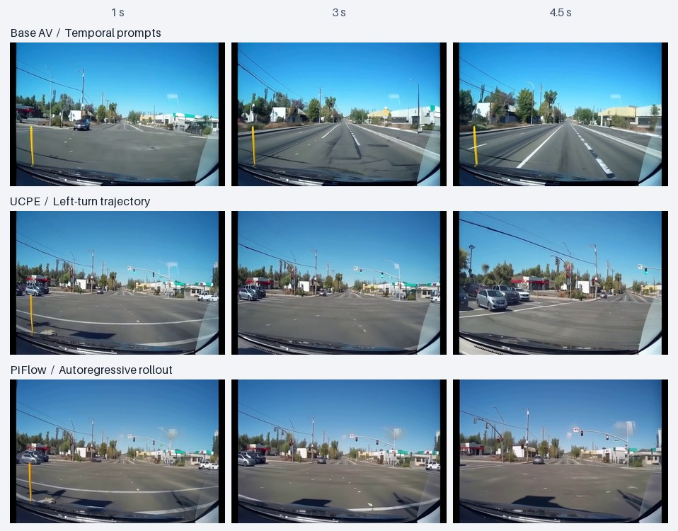

# Kandinsky WM 1.5 · Autonomous Driving

Kandinsky WM 1.5 generates road scenes from images, prompts and camera trajectories. Base AV adapts the pretrained video backbone of Kandinsky 6.0 Video Lite to autonomous driving. UCPE lets you specify the observing camera's path. PiFlow generates successive chunks while retaining the scene's history. [Kandinsky 6.0 Video technical report](https://arxiv.org/abs/2610.05608)



| Model | Use it to | Inputs | Code |
|---|---|---|---|
| **Base AV** | Generate a driving clip or continue a video | Image or video prefix, text | [Base AV quickstart](base_av/README.md) |
| **UCPE** | Generate or continue a clip with explicit camera control | Text, standalone camera trajectory, optional image or video prefix | [UCPE quickstart](ucpe/README.md) |
| **PiFlow** | Render a longer sequence by carrying history across chunks | Initial context, text, standalone camera trajectory | [PiFlow quickstart](piflow/README.md) |

[Previous Kandinsky WM release](https://github.com/kandinskylab/kandinsky-wm) · [Example inputs and coordinate conventions](examples/README.md) · [Weight bundles](docs/weights.md) · [Reproducibility](docs/reproducibility.md)

## Installation

Use Python 3.12 in a dedicated environment for the model you want to run. Each quickstart lists its validated GPU environment and FlashAttention prerequisites. Run the commands below from the repository root.

Obtain the release weight directory from the model card or use an already staged bundle. For Hub downloads, pin the model card's listed revision with `kwm-av fetch`. [Bundle format and download command](docs/weights.md)

Install the weight utility and verify a staged bundle in the same environment.

```bash
python -m pip install -e '.[hub]'
kwm-av inspect weights/base-av --model base-av --verify
```

## Base AV

Generate from the example frame. Use the same seed and prompt when comparing two implementations.

```bash
python -m base_av --mode i2v --model-dir weights/base-av \
  --image examples/reference.jpg --prompt "$(cat examples/prompt.txt)" \
  --seed 42 --output outputs/base-av.mp4
```

For continuation, pass `--mode v2v`, an input video through `--video` and an observed prefix length through `--prefix-frames`. [Base AV quickstart](base_av/README.md)

Base AV can also assign different prompts to different portions of a clip. [Temporal prompt JSON and examples](base_av/README.md)

## UCPE

Start from one image and compare `examples/straight.json` with `examples/left.json`. Both files specify camera-to-world matrices and pixel intrinsics independently of the image and prompt. The merged UCPE weights are loaded as one inference checkpoint.

```bash
python -m ucpe --weights-dir weights/ucpe --image examples/reference.jpg \
  --prompt-file examples/prompt.txt --trajectory examples/straight.json \
  --deterministic --seed 42 --output outputs/ucpe-straight.mp4
```

Repeat with `examples/left.json` and a different output path to compare the trajectories. UCPE also accepts a video prefix or generates from text and a calibrated trajectory. [UCPE quickstart](ucpe/README.md) · [Coordinate convention](docs/ucpe.md)

## PiFlow

Use `examples/rollout.json` to replay multiple chunks, including a history reset. The runtime advances the latent history with each generated chunk. Render the full example with the Turbo decoder.

```bash
TORCH_COMPILE_DISABLE=1 python -m piflow --weights weights/piflow \
  --image examples/reference.jpg --prompt-file examples/prompt.txt \
  --trajectory examples/rollout.json --deterministic --seed 42 \
  --output outputs/piflow.mp4
```

The PiFlow guide covers direct prompt encoding, precomputed text features, the decoder and the optional final-step model. [PiFlow quickstart](piflow/README.md)

## Repository layout

| Directory | Responsibility |
|---|---|
| `base_av/` | Text-conditioned image and video inference |
| `ucpe/` | Camera-conditioned inference and checkpoint export |
| `piflow/` | Causal generation, solver, history and chunk decoding |
| `examples/` | Reference frame, prompt and standalone metric camera paths |
| `kwm_av/` | Model-agnostic weight downloads and integrity checks |
| `tests/`, `tools/` | Release checks and decoded-video comparison |

The repository code uses the MIT license. See the third-party notices for included upstream code and the applicable Hub model cards for weight terms. [Code license](LICENSE) · [Third-party notices](THIRD_PARTY_NOTICES.md)
