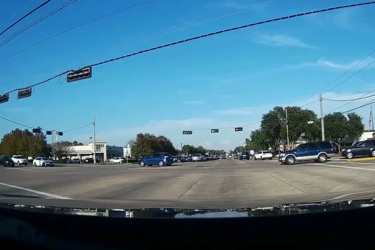
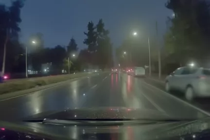
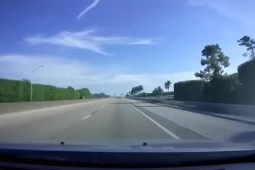
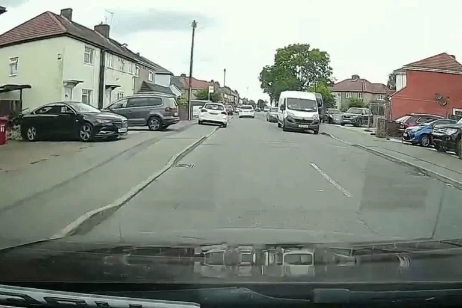
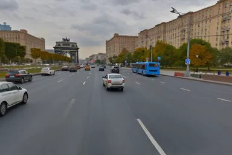
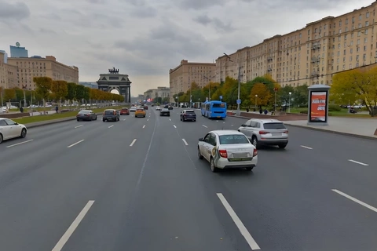

<div align="center">


# Kandinsky WM 1.5 · Autonomous Driving

[Model weights](https://huggingface.co/kandinskylab/Kandinsky-WM-1.5-AV) · [Hugging Face collection (team access)](https://huggingface.co/collections/kandinskylab/kandinsky-wm-15-6b0420ff37178b56f3ae1f14) · [Kandinsky WM 1.0](https://github.com/kandinskylab/kandinsky-wm) · [Habr article on WM 1.0](https://habr.com/ru/companies/sberbank/articles/1054966/)

</div>

Kandinsky WM 1.5 generates road scenes from images, prompts and camera trajectories. Base AV adapts the pretrained video backbone of Kandinsky 6.0 Video Lite to autonomous driving. UCPE lets you specify the observing camera's path. AR generates successive chunks while retaining the scene's history. [Kandinsky 6.0 Video technical report](https://arxiv.org/abs/2610.05608)

| Model | Use it to | Inputs | Code |
|---|---|---|---|
| **Base AV** | Generate a driving clip or continue a video | Image or video prefix, text | [Base AV quickstart](src/base_av/README.md) |
| **UCPE** | Generate or continue a clip with explicit camera control | Text, standalone camera trajectory, optional image or video prefix | [UCPE quickstart](src/ucpe/README.md) |
| **AR** | Render a longer sequence by carrying history across chunks | Initial context, text, standalone camera trajectory | [AR quickstart](src/ar/README.md) |
| **F2LF** | Generate a transition between two calibrated views | First and last frames, text, standalone camera geometry | [F2LF quickstart](src/f2lf/README.md) |

[Example inputs and coordinate conventions](examples/README.md) · [Weight bundles](docs/weights.md) · [Reproducibility](docs/reproducibility.md)

## Examples

### Base AV

Select a WebP preview to open the generated MP4 file. These showcase clips use super-resolution. Each clip includes its original prompt.

| Intersection collision | Driving in rain at night |
| --- | --- |
| [](examples/base-av/intersection-collision/video.mp4) | [](examples/base-av/rainy-night/video.mp4) |
| [Input frame](examples/base-av/intersection-collision/reference.jpg) · [Prompt](examples/base-av/intersection-collision/prompt.txt) | [Input frame](examples/base-av/rainy-night/reference.jpg) · [Prompt](examples/base-av/rainy-night/prompt.txt) |

| Motorcycle overtake | Opening car door |
| --- | --- |
| [](examples/base-av/motorcycle-overtake/video.mp4) | [](examples/base-av/opening-car-door/video.mp4) |
| [Input frame](examples/base-av/motorcycle-overtake/reference.jpg) · [Prompt](examples/base-av/motorcycle-overtake/prompt.txt) | [Input frame](examples/base-av/opening-car-door/reference.jpg) · [Prompt](examples/base-av/opening-car-door/prompt.txt) |

### UCPE camera control

Four continuations share a reference frame, prompt and seed. [Shared reference frame](examples/reference.jpg) · [Shared prompt](examples/prompt.txt)

| Left turn | Right turn |
| --- | --- |
| [](examples/ucpe/left.mp4) | [](examples/ucpe/right.mp4) |
| [Trajectory](examples/left.json) | [Trajectory](examples/right.json) |

| Straight ahead | Stationary camera |
| --- | --- |
| [](examples/ucpe/straight.mp4) | [](examples/ucpe/stationary.mp4) |
| [Trajectory](examples/straight.json) | [Trajectory](examples/stationary.json) |

### F2LF endpoint control

Both clips share the same reference images, captions and endpoint poses. The camera takes a straight path in the first clip and passes 3.5 m to the right of the midpoint in the second. [First frame](examples/f2lf/first.png) · [Last frame](examples/f2lf/last.png) · [Camera geometry](examples/f2lf/camera.json) · [Prompt](examples/f2lf/prompt.txt) · [Scene caption](examples/f2lf/scene.txt)

| Straight path | Right arc |
| --- | --- |
| [](examples/f2lf/straight.mp4) | [](examples/f2lf/right.mp4) |

## PAI-Bench-G results

The final Base AV checkpoint was evaluated on the image-to-video autonomous-driving subset. Scores are on a 0–100 scale and give each video equal weight. The accident subset is included in the 118-scene total. [PAI-Bench-G](https://github.com/SHI-Labs/physical-ai-bench/tree/main/generation) · [Reproduce the benchmark](docs/benchmark.md)

| Final Base AV | Scenes | Qwen3-VL 235B ↑ | ChatGPT 6.1 Sol Extra High ↑ |
| --- | ---: | ---: | ---: |
| All AV scenes | 118 | **78.06** | **71.32** |
| Accident scenes | 8 | **81.80** | **76.71** |

Qwen3-VL is the judge used for the reference benchmark run. ChatGPT is a supplementary frame-based evaluation on the same clips.

## Installation

Use Python 3.12 in a dedicated environment for the model you want to run. Each quickstart lists its validated GPU environment and FlashAttention prerequisites. Run the commands below from the repository root.

Choose a model subfolder from the Hub repository or use an already staged bundle. For Hub downloads, pin the model card's listed revision with `kwm-av fetch`. [Bundle format and download command](docs/weights.md)

Install the weight utility and verify a staged bundle in the same environment.

```bash
python -m pip install -e '.[hub]'
kwm-av inspect weights/base-av --model base-av --verify
```

## Base AV

Generate from the example frame. Use the same seed and prompt when comparing two implementations.

```bash
python scripts/infer_base_av.py --mode i2v --model-dir weights/base-av \
  --image examples/reference.jpg --prompt "$(cat examples/prompt.txt)" \
  --seed 42 --output outputs/base-av.mp4
```

For continuation, pass `--mode v2v`, an input video through `--video` and an observed prefix length through `--prefix-frames`. [Base AV quickstart](src/base_av/README.md)

Base AV can also assign different prompts to different portions of a clip. [Temporal prompt JSON and examples](src/base_av/README.md)

## UCPE

Start from one image and compare the four example camera paths. Each file specifies camera-to-world matrices and pixel intrinsics independently of the image and prompt. The merged UCPE weights are loaded as one inference checkpoint.

```bash
python scripts/infer_ucpe.py --weights-dir weights/ucpe --image examples/reference.jpg \
  --prompt-file examples/prompt.txt --trajectory examples/straight.json \
  --deterministic --seed 42 --output outputs/ucpe-straight.mp4
```

Repeat with `examples/left.json`, `examples/right.json` or `examples/stationary.json` and a different output path. UCPE also accepts a video prefix or generates from text and a calibrated trajectory. [UCPE quickstart](src/ucpe/README.md) · [Coordinate convention](docs/ucpe.md)

## AR

Use `examples/rollout.json` to replay multiple chunks, including a history reset. The runtime advances the latent history with each generated chunk. Render the full example with the Turbo decoder.

```bash
TORCH_COMPILE_DISABLE=1 python scripts/infer_ar.py --weights weights/ar \
  --image examples/reference.jpg --prompt-file examples/prompt.txt \
  --trajectory examples/rollout.json --deterministic --seed 42 \
  --output outputs/ar.mp4
```

The AR guide covers direct prompt encoding, precomputed text features, the decoder and the optional final-step model. [AR quickstart](src/ar/README.md)

## F2LF

Generate a five-second transition between two reference images with calibrated camera poses. Use `--offset-m 3.5` and a new output path to generate a right arc between the same anchors.

```bash
python scripts/infer_f2lf.py --weights weights/f2lf \
  --a examples/f2lf/first.png --b examples/f2lf/last.png \
  --camera examples/f2lf/camera.json \
  --prompt-file examples/f2lf/prompt.txt --scene-file examples/f2lf/scene.txt \
  --deterministic --seed 2026102991 --output outputs/f2lf-straight.mp4
```

[F2LF quickstart and camera format](src/f2lf/README.md)

## Repository layout

| Directory | Responsibility |
|---|---|
| `src/base_av/` | Text-conditioned image and video inference |
| `src/ucpe/` | Camera-conditioned inference and checkpoint export |
| `src/ar/` | Causal generation, solver, history and chunk decoding |
| `src/f2lf/` | Two-reference generation, metric camera geometry and RF sampling |
| `scripts/` | Inference launchers for all four models |
| `examples/` | Reference frame, prompt and standalone metric camera paths |
| `src/kwm_av/` | Model-agnostic weight downloads and integrity checks |
| `tests/`, `tools/` | Release checks and decoded-video comparison |

The repository code uses the MIT license. See the third-party notices for included upstream code and the applicable Hub model cards for weight terms. [Code license](LICENSE) · [Third-party notices](THIRD_PARTY_NOTICES.md)
