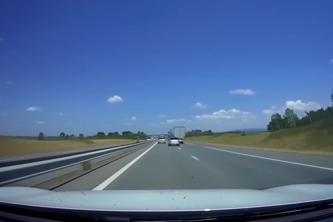
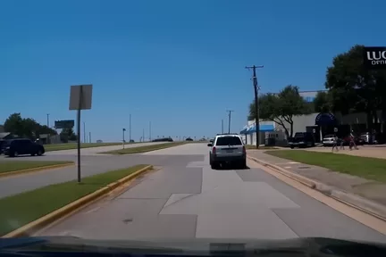
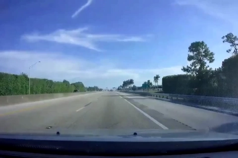
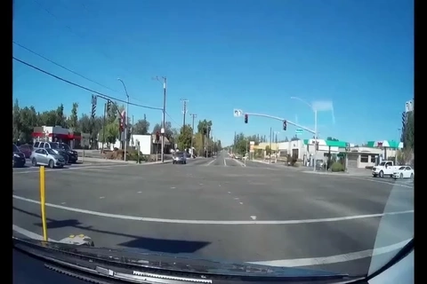
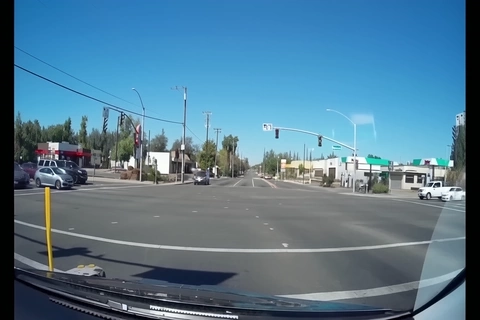
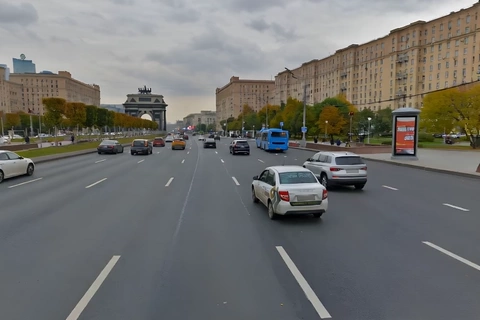
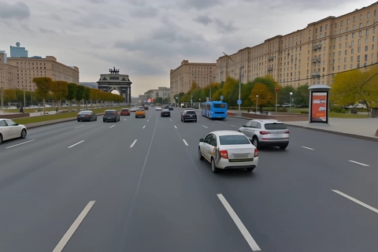
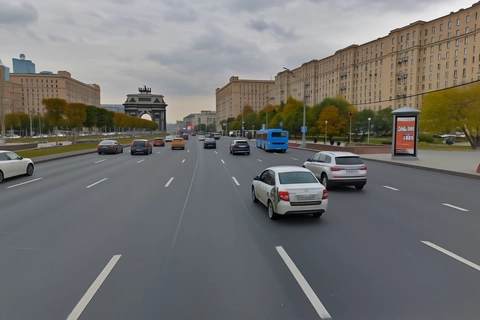

<div align="center">


# Kandinsky WM 1.5 · Autonomous Driving

[Model weights](https://huggingface.co/kandinskylab/Kandinsky-WM-1.5-AV) · [Hugging Face collection (team access)](https://huggingface.co/collections/kandinskylab/kandinsky-wm-15-6b0420ff37178b56f3ae1f14) · [Kandinsky WM 1.0](https://github.com/kandinskylab/kandinsky-wm) · [Habr article on WM 1.0](https://habr.com/ru/companies/sberbank/articles/1054966/)

</div>

Kandinsky WM 1.5 generates road scenes from images, prompts and camera trajectories. Base AV adapts the pretrained video backbone of Kandinsky 6.0 Video Lite to autonomous driving. UCPE lets you specify the observing camera's path. AR generates successive chunks while retaining the scene's history. [Kandinsky 6.0 Video technical report](https://arxiv.org/abs/2610.05608)

| Model | Use it to | Inputs | Code |
|---|---|---|---|
| **Base AV** | Generate a driving clip or continue a video | Image or video prefix, text | [Base AV quickstart](src/base_av/README.md) |
| **UCPE** | Generate or continue a clip with explicit camera control | Text, standalone camera trajectory, optional image or video prefix | [UCPE quickstart](src/ucpe/README.md) |
| **AR** | Render a longer sequence by carrying history across chunks | Initial context, text, standalone camera trajectory | [AR quickstart](src/ar/README.md) |
| **F2LF** | Generate a transition between two calibrated views | First and last frames, text, standalone camera geometry | [F2LF quickstart](src/f2lf/README.md) |

[Example inputs and coordinate conventions](examples/README.md) · [Weight bundles](docs/weights.md) · [Reproducibility](docs/reproducibility.md)

## Examples

### Base AV

Click a looping WebP to play its MP4. The Base AV examples use super-resolution and include their original prompts.

| Intersection collision | Driving in rain at night |
| --- | --- |
| [](https://huggingface.co/datasets/sashakunitsyn/static_videos/resolve/bf803ac13e18eddf5211862535cd40ee9b884734/kandinsky-wm-1.5/av/base-av/intersection-collision.mp4) | [](https://huggingface.co/datasets/sashakunitsyn/static_videos/resolve/bf803ac13e18eddf5211862535cd40ee9b884734/kandinsky-wm-1.5/av/base-av/rainy-night.mp4) |
| [Input frame](examples/base-av/intersection-collision/reference.jpg) · [Prompt](examples/base-av/intersection-collision/prompt.txt) | [Input frame](examples/base-av/rainy-night/reference.jpg) · [Prompt](examples/base-av/rainy-night/prompt.txt) |

| Motorcycle overtake | Opening car door |
| --- | --- |
| [](https://huggingface.co/datasets/sashakunitsyn/static_videos/resolve/bf803ac13e18eddf5211862535cd40ee9b884734/kandinsky-wm-1.5/av/base-av/motorcycle-overtake.mp4) | [](https://huggingface.co/datasets/sashakunitsyn/static_videos/resolve/bf803ac13e18eddf5211862535cd40ee9b884734/kandinsky-wm-1.5/av/base-av/opening-car-door.mp4) |
| [Input frame](examples/base-av/motorcycle-overtake/reference.jpg) · [Prompt](examples/base-av/motorcycle-overtake/prompt.txt) | [Input frame](examples/base-av/opening-car-door/reference.jpg) · [Prompt](examples/base-av/opening-car-door/prompt.txt) |

### Accident scenes

Base AV renders from the PAI-Bench-G accident subset. [Input frames, prompts and generation commands](examples/accidents/README.md)

| Intersection rollover | Highway trailer collision | Pickup and SUV collision |
| --- | --- | --- |
| [](https://huggingface.co/datasets/sashakunitsyn/static_videos/resolve/bf803ac13e18eddf5211862535cd40ee9b884734/kandinsky-wm-1.5/av/accidents/intersection-rollover.mp4) | [](https://huggingface.co/datasets/sashakunitsyn/static_videos/resolve/bf803ac13e18eddf5211862535cd40ee9b884734/kandinsky-wm-1.5/av/accidents/highway-trailer-collision.mp4) | [](https://huggingface.co/datasets/sashakunitsyn/static_videos/resolve/bf803ac13e18eddf5211862535cd40ee9b884734/kandinsky-wm-1.5/av/accidents/pickup-and-suv.mp4) |

### Temporal text · motorcycle entry

Four Base AV runs use the same image and seed. The prompt schedules move the rider's entry through the clip. The times below label the requested entry windows. [Prompts and reproduction command](examples/base-av/temporal-motorcycle/README.md)

| Prompted at 0.5 s | Prompted at 1.5 s |
| --- | --- |
| [](https://huggingface.co/datasets/sashakunitsyn/static_videos/resolve/bf803ac13e18eddf5211862535cd40ee9b884734/kandinsky-wm-1.5/av/base-av/temporal-motorcycle/entry-0.5s.mp4) | [](https://huggingface.co/datasets/sashakunitsyn/static_videos/resolve/bf803ac13e18eddf5211862535cd40ee9b884734/kandinsky-wm-1.5/av/base-av/temporal-motorcycle/entry-1.5s.mp4) |

| Prompted at 2.5 s | Prompted at 3.5 s |
| --- | --- |
| [](https://huggingface.co/datasets/sashakunitsyn/static_videos/resolve/bf803ac13e18eddf5211862535cd40ee9b884734/kandinsky-wm-1.5/av/base-av/temporal-motorcycle/entry-2.5s.mp4) | [](https://huggingface.co/datasets/sashakunitsyn/static_videos/resolve/bf803ac13e18eddf5211862535cd40ee9b884734/kandinsky-wm-1.5/av/base-av/temporal-motorcycle/entry-3.5s.mp4) |

### UCPE camera control

Four continuations share a reference frame, prompt and seed. [Shared reference frame](examples/reference.jpg) · [Shared prompt](examples/prompt.txt)

| Left turn | Right turn |
| --- | --- |
| [](https://huggingface.co/datasets/sashakunitsyn/static_videos/resolve/bf803ac13e18eddf5211862535cd40ee9b884734/kandinsky-wm-1.5/av/ucpe/left.mp4) | [](https://huggingface.co/datasets/sashakunitsyn/static_videos/resolve/bf803ac13e18eddf5211862535cd40ee9b884734/kandinsky-wm-1.5/av/ucpe/right.mp4) |
| [Trajectory](examples/left.json) | [Trajectory](examples/right.json) |

| Straight ahead | Stationary camera |
| --- | --- |
| [](https://huggingface.co/datasets/sashakunitsyn/static_videos/resolve/bf803ac13e18eddf5211862535cd40ee9b884734/kandinsky-wm-1.5/av/ucpe/straight.mp4) | [](https://huggingface.co/datasets/sashakunitsyn/static_videos/resolve/bf803ac13e18eddf5211862535cd40ee9b884734/kandinsky-wm-1.5/av/ucpe/stationary.mp4) |
| [Trajectory](examples/straight.json) | [Trajectory](examples/stationary.json) |

### F2LF endpoint control

Four camera paths share the same endpoints, captions and seed. The controls move the midpoint while keeping both ends of the path fixed. [Inputs and reproduction command](examples/f2lf/directions/README.md)

| Straight path | 3.5 m left arc |
| --- | --- |
| [](https://huggingface.co/datasets/sashakunitsyn/static_videos/resolve/f2ed40c04f7ebf56779bddf00d2063bd7c522f09/kandinsky-wm-1.5/av/f2lf/directions/straight.mp4) | [](https://huggingface.co/datasets/sashakunitsyn/static_videos/resolve/f2ed40c04f7ebf56779bddf00d2063bd7c522f09/kandinsky-wm-1.5/av/f2lf/directions/left-3.5m.mp4) |

| 3.5 m right arc | 5 m right arc |
| --- | --- |
| [](https://huggingface.co/datasets/sashakunitsyn/static_videos/resolve/f2ed40c04f7ebf56779bddf00d2063bd7c522f09/kandinsky-wm-1.5/av/f2lf/directions/right-3.5m.mp4) | [](https://huggingface.co/datasets/sashakunitsyn/static_videos/resolve/f2ed40c04f7ebf56779bddf00d2063bd7c522f09/kandinsky-wm-1.5/av/f2lf/directions/right-5m.mp4) |

## PAI-Bench-G results

The compared runs cover the same 118 image-to-video scene IDs and benchmark questions. Each video contributes equally to the accuracy score. The eight accident scenes are included in the AV total. [PAI-Bench-G](https://github.com/SHI-Labs/physical-ai-bench/tree/main/generation) · [Protocol and scores](docs/benchmark.md)

| Model | Qwen3-VL 235B · AV ↑ | Qwen3-VL 235B · Accidents ↑ | ChatGPT frame review · AV ↑ | ChatGPT frame review · Accidents ↑ |
| --- | ---: | ---: | ---: | ---: |
| **Kandinsky WM 1.5 Base AV** | **78.06** | **81.80** | 71.32 | 76.71 |
| MiniMax H3 | 76.84 | 76.07 | 71.42¹ | 76.15¹ |
| Cosmos3-Nano | 74.94 | 67.18 | 68.98 | 49.63 |
| Cosmos3-Edge | 65.91 | 34.79 | 60.15 | 15.00 |

The Qwen scores share an evaluator and question set. Generation settings and prompt adaptation vary by model. The ChatGPT columns report supplementary sampled-frame reviews. ¹ MiniMax H3 used a separate ChatGPT review. [Per-scene scores](docs/paibench-av118-scores.csv) · [MiniMax H3 review](https://gigaeye-kandinsky-spark.obs.ru-moscow-1.hc.sbercloud.ru/bulygin/habr/physical_ai_av/research/pai_h3_chatgpt_20261116/results.json)

## Installation

Use Python 3.12 in a dedicated environment for the model you want to run. Each quickstart lists its validated GPU environment and FlashAttention prerequisites. Run the commands below from the repository root.

Install the weight utility and download the model you want to run. The command below selects Base AV at the pinned release revision and verifies its files. Use `--model ucpe`, `--model ar` or `--model f2lf` to download another bundle. [Weight bundles and AR components](docs/weights.md)

```bash
python -m pip install -e '.[hub]'
kwm-av fetch --repo-id kandinskylab/Kandinsky-WM-1.5-AV \
  --revision 4d0011bb8650201985e51d39b2a1d75240ab37b5 \
  --model base-av --output weights
```

## Base AV

Generate from the example frame. Use the same seed and prompt when comparing two implementations.

```bash
python scripts/infer_base_av.py --mode i2v --model-dir weights/base-av \
  --image examples/reference.jpg --prompt "$(cat examples/prompt.txt)" \
  --seed 42 --output outputs/base-av.mp4
```

For continuation, pass `--mode v2v`, an input video through `--video` and an observed prefix length through `--prefix-frames`. [Base AV quickstart](src/base_av/README.md)

Base AV can also assign different prompts to different portions of a clip. [Temporal prompt JSON and examples](src/base_av/README.md)

## UCPE

Start from one image and compare the four example camera paths. Each file specifies camera-to-world matrices and pixel intrinsics independently of the image and prompt. The merged UCPE weights are loaded as one inference checkpoint.

```bash
python scripts/infer_ucpe.py --weights-dir weights/ucpe --image examples/reference.jpg \
  --prompt-file examples/prompt.txt --trajectory examples/straight.json \
  --deterministic --seed 42 --output outputs/ucpe-straight.mp4
```

Repeat with `examples/left.json`, `examples/right.json` or `examples/stationary.json` and a different output path. UCPE also accepts a video prefix or generates from text and a calibrated trajectory. [UCPE quickstart](src/ucpe/README.md) · [Coordinate convention](docs/ucpe.md)

## AR

Use `examples/rollout.json` to replay multiple chunks, including a history reset. The runtime advances the latent history with each generated chunk. Render the full example with the Turbo decoder.

```bash
TORCH_COMPILE_DISABLE=1 python scripts/infer_ar.py --weights weights/ar \
  --image examples/reference.jpg --prompt-file examples/prompt.txt \
  --trajectory examples/rollout.json --deterministic --seed 42 \
  --output outputs/ar.mp4
```

The AR guide covers direct prompt encoding, precomputed text features, the decoder and the optional final-step model. [AR quickstart](src/ar/README.md)

## F2LF

Generate a five-second transition between two reference images with calibrated camera poses. Use `--offset-m 3.5` and a new output path to generate a right arc between the same anchors.

```bash
python scripts/infer_f2lf.py --weights weights/f2lf \
  --a examples/f2lf/first.png --b examples/f2lf/last.png \
  --camera examples/f2lf/camera.json \
  --prompt-file examples/f2lf/prompt.txt --scene-file examples/f2lf/scene.txt \
  --deterministic --seed 2026102991 --output outputs/f2lf-straight.mp4
```

[F2LF quickstart and camera format](src/f2lf/README.md)

## Repository layout

| Directory | Responsibility |
|---|---|
| `src/base_av/` | Text-conditioned image and video inference |
| `src/ucpe/` | Camera-conditioned inference and checkpoint export |
| `src/ar/` | Causal generation, solver, history and chunk decoding |
| `src/f2lf/` | Two-reference generation, metric camera geometry and RF sampling |
| `scripts/` | Inference launchers for all four models |
| `examples/` | Reference frame, prompt and standalone metric camera paths |
| `src/kwm_av/` | Model-agnostic weight downloads and integrity checks |
| `tests/`, `tools/` | Release checks and decoded-video comparison |

The repository code uses the MIT license. [Code license](LICENSE) · [Third-party notices](THIRD_PARTY_NOTICES.md)
