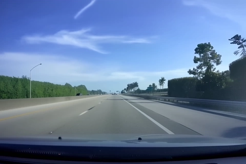
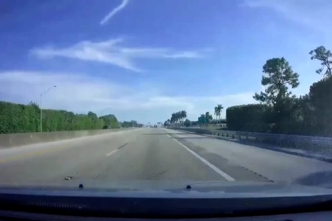
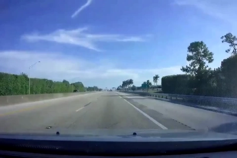

# Motorcycle entry timing with Base AV

Each clip uses the same conditioning image, seed and model. The four prompt schedules move the rider's entry from the lower left through successive one-second intervals. The timing in the labels comes from the prompts. The first visible parts of the motorcycle appear in the same order, with some variation in their exact timing. [Conditioning image](../motorcycle-overtake/reference.jpg) · [Prompt schedules](prompts.json)

| Prompted entry at 0.5 s | Prompted entry at 1.5 s |
| --- | --- |
| [](https://huggingface.co/datasets/sashakunitsyn/static_videos/resolve/bf803ac13e18eddf5211862535cd40ee9b884734/kandinsky-wm-1.5/av/base-av/temporal-motorcycle/entry-0.5s.mp4) | [](https://huggingface.co/datasets/sashakunitsyn/static_videos/resolve/bf803ac13e18eddf5211862535cd40ee9b884734/kandinsky-wm-1.5/av/base-av/temporal-motorcycle/entry-1.5s.mp4) |

| Prompted entry at 2.5 s | Prompted entry at 3.5 s |
| --- | --- |
| [](https://huggingface.co/datasets/sashakunitsyn/static_videos/resolve/bf803ac13e18eddf5211862535cd40ee9b884734/kandinsky-wm-1.5/av/base-av/temporal-motorcycle/entry-2.5s.mp4) | [](https://huggingface.co/datasets/sashakunitsyn/static_videos/resolve/bf803ac13e18eddf5211862535cd40ee9b884734/kandinsky-wm-1.5/av/base-av/temporal-motorcycle/entry-3.5s.mp4) |

## Reproduce the clips

Install the Base AV environment and download the Base AV bundle. Run from the repository root. [Environment setup](../../../src/base_av/README.md#environment) · [Weight bundle](../../../docs/weights.md)

```bash
python scripts/infer_base_av.py --mode i2v --model-dir weights/base-av \
  --input examples/base-av/temporal-motorcycle/prompts.json \
  --temporal-text hard --output-frames 120 --visual-size 512 \
  --num-steps 50 --guidance-weight 5 --scheduler-scale 5 --seed 42 \
  --output-dir outputs/temporal-motorcycle
```

The recipe generates native 768×512 MP4s at 24 fps. The Euler schedule uses 50 points and 49 updates. Add `--start 2 --limit 1` to reproduce only the 2.5 s schedule. Add `--dry-run` to check input and output paths without a GPU.

Separate single-GPU H100 runs with this command reproduced all four source MP4s byte for byte.

The animated WebPs show the source checkpoint's four renders at 480×320. Each loop displays all 120 frames in about five seconds. [Original MP4 gallery](https://gigaeye-kandinsky-spark.obs.ru-moscow-1.hc.sbercloud.ru/bulygin/html_samples/av_motorcycle_temporal_kwm15_hf_20261124/index.html)

To make the same WebP previews from your generated MP4s, use FFmpeg with `libwebp_anim`.

```bash
for entry in 0.5 1.5 2.5 3.5; do
  ffmpeg -i "outputs/temporal-motorcycle/av_motorcycle_1_0__entry_${entry}s__42.mp4" \
    -vf scale=480:320:flags=lanczos -an -c:v libwebp_anim -preset picture \
    -quality 95 -compression_level 6 -loop 0 "outputs/temporal-motorcycle/entry-${entry}s.webp"
done
```
